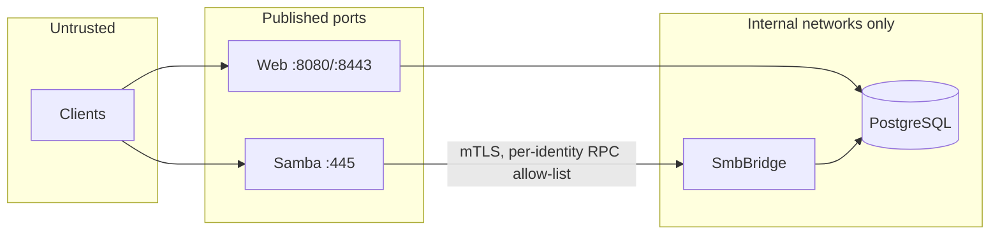

# Security Model

This document describes how Kaimo File Server authenticates callers, authorizes file and
administrative operations, and protects secrets at rest and in transit.

Related: [System overview](system-overview.md) · [Domain model](domain-model.md) ·
[SMB control plane](../external-access/smb/control-plane-grpc.md) · [REST API v1](../external-access/rest-api.md)

## Trust boundaries

- Only the Web host (HTTP/HTTPS) and Samba (SMB) accept external connections. In the development
  stack Elasticsearch and Adminer are bound to loopback; the example stack publishes neither.
- The database, the SMB control plane and Elasticsearch (no authentication, `xpack.security`
  disabled) sit on `internal` Docker networks. Only Web and Host join the search network.
- Known residual risk: Web is on the search network, so a user with `ManageConnections` can still
  point a WebDAV storage connection at `http://elasticsearch:9200`. There is no deny-list in the
  connection test and no Elasticsearch authentication.
- Every file operation, regardless of protocol, is authorized by the same `IAclService` in Core.

## Authentication

| Channel | Mechanism | Implementation |
|---|---|---|
| Web UI (Blazor Server) | Username/password (+ optional TOTP second factor, see [Second factor](#second-factor-web-login)) → JWT in the HttpOnly session cookie `__Host-kaimo_session` (see [Web session](#web-session)); logout revokes the token ID (`jti`) in `revoked_web_tokens` | `src/Kaimo_File_Server.Web/Services/JwtTokenService.cs`, `JwtAuthenticationStateProvider.cs`, `WebSessionCookie.cs` |
| REST API `/api/v1` | Device-scoped JWT bearer + rotating refresh tokens | `src/Kaimo_File_Server.Web/Controllers/Api/AuthApiController.cs`, `Services/Api/ApiTokenService.cs` |
| WebDAV `/dav` | HTTP Basic (verified against the user store) or the device-scoped JWT bearer | `src/Kaimo_File_Server.Web/Controllers/WebDav/WebDavBasicAuthenticationHandler.cs` |
| SMB | NTLMv2 by Samba against NT hashes provisioned from the database | [SMB control plane](../external-access/smb/control-plane-grpc.md) |
| Public share links | Unguessable token in the URL, no account | [Downloads and share links](../external-access/downloads-and-share-links.md) |

Common rules:

- **Passwords** are hashed with BCrypt (`src/Kaimo_File_Server.Infrastructure/PasswordService.cs`).
  Empty passwords are rejected; failed and successful checks take comparable time so usernames
  cannot be enumerated.
- **Lockout.** `LoginThrottle` (`src/Kaimo_File_Server.Core/Security/LoginThrottle.cs`) locks a key
  after consecutive failures. `CredentialLoginService` charges every attempt against three keys
  (values in `LoginProtectionSettings`, editable under Settings → Login protection):
  - the client address across all user names (`security.login.ipMaxAttempts` 15,
    `security.login.ipLockoutMinutes` 30). Checked first, so once the address is locked further
    attempts cost neither a database lookup nor a password hash;
  - user name + client address (`app.user.maxLoginAttempts` 5, `app.user.lockoutMinutes` 15);
  - the account across all addresses (`security.login.accountWideFactor` × the per-user limit, default 10×).

  A successful login resets all three. The state is held in process memory. Known residual risk:
  an attacker with a valid account of their own can reset their address budget by signing in;
  the per-user and account-wide limits and the request limit below are not affected.
- **Share-link passwords** use the same throttle (`ShareLinkService.VerifyPasswordAsync`) with two
  keys: link + client address (`security.sharelink.passwordMaxAttemptsPerAddress` 5) and the link
  across all addresses (`security.sharelink.passwordMaxAttemptsPerLink` 50), both locked for
  `security.sharelink.passwordLockoutMinutes` (30). The address is checked first, so a locked
  address neither costs a password hash nor counts toward the link limit: one address only locks
  itself out, while guessing spread over many addresses still locks the link for everyone. Without
  a known address only the link limit applies. A correct password resets both counters.
- **Request limit.** `/api/v1/auth/*` (login, refresh, logout) is limited to 20 requests per minute
  and client address (`AuthApiController.RateLimitPolicy`), independent of the lockout.
- **Lock scope.** `LoginResult.LockScope` tells an account lock (user name + address, or
  account-wide) from an address lock. An account lock raises `security.account_locked`; an
  address lock raises `security.address_locked` for the security administrators instead (a
  locked address refuses every user name, so notifying the names tried from it would report
  accounts as locked that are not). Both are sent once per lock; all address locks share one
  dedup key, so a distributed attack yields one mail per throttle window.
- **Login log.** LockedOut attempts that hit the same lock (channel, account, address) are folded
  into one `login_attempts` row with a `RepeatCount`; the security overview sums the count.
  Attempts refused by a locked address are logged as `AddressLockedOut` without a user name, fold
  per (channel, address) and count as failures, but never as locked accounts.
- **JWT.** Tokens are HMAC-SHA256 with the algorithm pinned during validation. `JwtTokenService.ValidateSecret`
  refuses to start with a short secret, a known public default, or a development secret outside the
  Development environment. Every token carries the account's `SecurityStamp`; changing the password
  rotates the stamp and invalidates all earlier tokens.
- **Bearer validation.** `BearerTokenValidation.ValidateAsync` (`src/Kaimo_File_Server.Web/Services/BearerTokenValidation.cs`)
  runs on every bearer-authenticated request: the token must be device-scoped (the web login token is
  not accepted), the device active, the account enabled and the security stamp current.
- **Web session validation.** `WebSessionValidation` (`src/Kaimo_File_Server.Web/Services/WebSessionValidation.cs`)
  is the counterpart for the web token: not device-scoped, unexpired, `jti` not revoked, account
  enabled, security stamp current. It runs when the Blazor connection is established and periodically
  for the circuit's lifetime (`app.session.revalidationSeconds`, default 30 s).
- **Access restrictions.** See [Access restrictions](#access-restrictions).
- **Security monitor.** `SecurityMonitor` records every credential check (web, API, WebDAV) and counts
  API/WebDAV requests per client into `login_attempts` and `client_activity`.
- There is no directory-service (LDAP/Active Directory/Kerberos) integration; all accounts are local.

### Web session

The web login JWT is never readable by script. It lives in the cookie `__Host-kaimo_session` with
`HttpOnly`, `Secure`, `SameSite=Strict` and `Path=/` (the `__Host-` prefix forbids a `Domain`
attribute and non-HTTPS writes). Its expiry equals the token's `exp` (`Jwt:ExpirationHours`).

- **Setting the cookie.** Login runs over the Blazor circuit, which cannot set cookies. After the
  credentials are verified the circuit issues a single-use, 30-second ticket (`WebSessionTicketStore`)
  and the page posts it with a same-origin `fetch` to `POST /auth/session` (`WebSessionController`),
  which sets the cookie. `POST /auth/logout` clears it after the circuit has revoked the `jti`. Both
  endpoints require HTTPS, an `Origin` naming this server and `Sec-Fetch-Site: same-origin` (when
  sent), and a JSON body — this rules out login CSRF and cross-site sign-out.
- **Where the cookie counts.** The default authentication scheme is a policy scheme
  (`WebSessionCookie.SelectScheme`): the `WebSession` scheme reads the cookie **only on the Blazor hub
  (`/_blazor`)**; every other path, including `/api/v1` and `/dav`, keeps the header-based schemes and
  never reads the cookie. The circuit receives the hub user through
  `IHostEnvironmentAuthenticationStateProvider` on connect and reconnect.
- **CSRF / cross-site WebSocket hijacking.** All state changes in the web UI run over the hub.
  `SameSite=Strict` keeps the cookie off cross-site requests; because other ports and subdomains of the
  same host are *same-site*, the hub additionally rejects foreign `Origin` headers (extra public
  origins behind a Host-rewriting proxy: `Web:AllowedOrigins`).
- **XSS.** A script injection can no longer exfiltrate the session token. It could still act through
  the open circuit while the page is open, so the nonce-based Content-Security-Policy remains the
  primary XSS defence.
- **Plain HTTP.** Browser requests on HTTP are redirected to HTTPS (`HttpsRedirection:HttpsPort`,
  default `Kestrel:HttpsPort`); `/api/v1` and `/dav` are not redirected. The client API (`/api/v1`)
  always rejects plain HTTP with `426 Upgrade Required` (`ApiError("https_required")`,
  `ApiHttpsRequirementMiddleware`), after the forwarded headers and before authentication, so no
  password or token is checked. WebDAV enforces HTTPS itself (`services.webdav.requireHttps`).

The client API and WebDAV are unaffected: their credentials (Authorization header) are never sent by
a browser on its own, the API has no CORS policy and accepts JSON bodies only, and `/dav` rejects
cross-site browser requests (see [WebDAV](../external-access/webdav.md#response-hardening)).

### Access restrictions

Administrators can limit where users, groups or departments may sign in from (Settings → Access
restrictions; rules in `AccessRestrictionSettings`, config key `security.access.restrictions`,
evaluated by `AccessRestrictionService`).

- A user covered by no enabled rule is unrestricted. A covered user (directly, through a group, or
  through a department including its sub-departments) is allowed when at least one covering rule
  matches: the request host (the address the server was reached under, from the central domain
  list) or the client IP (CIDR ranges). An unknown client address fails closed.
- The host comes from the client, so only the IP ranges are a hard boundary. Behind a reverse proxy,
  client IPs are only real when the proxy is trusted (`ForwardedHeaders`), and host rules require the
  proxy to pass the `Host` header through.
- Enforcement: the login service after a successful password check (`LoginOutcome.AddressNotAllowed`;
  web, REST, WebDAV Basic). To the client it is indistinguishable from a wrong password (same message /
  401, counted towards lockout, no throttle reset), so it never confirms valid credentials; only the
  security log names the reason. Further: the token refresh, `AccessRestrictionMiddleware`
  after authorization on every authenticated request (API and WebDAV incl. its credential cache:
  403 `address_not_allowed`; Blazor hub connect: the session cookie is ignored, so the circuit starts
  anonymous on the login page), and the periodic circuit revalidation.
- Not covered: SMB, anonymous share links, and download tickets issued inside an already checked circuit.
  SMB has its own network list instead (`SmbAllowedNetworks`, applied by `sync-config.sh` as Samba
  `hosts allow`, loopback always prepended; a change disconnects all SMB sessions), and Samba's own
  account lockout (tdbsam account policies from the "Login protection" tab). SMB login events reach
  the security overview through the log forwarder → `kaimo_authreport` → `SecurityEventService`.
  `SmbAuthenticationRecorder` stores successes and failures as counted rows (account, address,
  outcome, hour); one address starts at most 20 failure rows per hour, further accounts' failures
  share one row of that address without an account, so a user-name spray cannot grow the table
  without bound. LockedOut events for unknown accounts are dropped (Samba answers LockedOut only
  for passdb accounts, so such a line is forged) and never notify.
- Saving rules that would block the saving administrator's own connection is refused. For recovery,
  `KAIMO_ACCESS_RESTRICTIONS_DISABLED=true` on the web container ignores every rule; on the
  `smb-bridge` container it also lifts the SMB network list.
- Rules and each user's resolved groups/departments are cached for 30 seconds.

### Second factor (web login)

The web login can ask for a TOTP code (RFC 6238: HMAC-SHA1, 6 digits, 30-second steps) after the
password. It applies to the **web login only**; the REST API, WebDAV and SMB keep authenticating
with the password alone (a deliberate decision, documented as residual risk in the policy tab and in
`example/DETAILS.md`).

- **Policy.** `SecondFactorPolicy` (config key `security.mfa.policy`, Settings → Two-factor sign-in,
  `ManageSystemSettings`): `Off` (nobody is asked; factors are kept), `Optional` (whoever set one up
  is asked), `Required` (additionally required from everyone, or from users, groups, roles held in
  any scope, departments with their sub-departments, and — default on — everyone holding any
  management permission). `SecondFactorPolicyService` evaluates it; the policy and the per-user
  session result are cached for 30 seconds. Saving a policy that would require a factor from the
  saving administrator, who has none, is refused.
- **Storage.** `user_second_factors` (secret, confirmation time, last used step) and
  `user_recovery_codes` (SHA-256 of 80-bit codes, single use), both deleted with the user. The secret
  is encrypted with Data Protection, purpose bound to the user id, so a row copied to another user
  does not decrypt. An unreadable secret (key ring lost on restore) fails closed: the code check
  reports `Unavailable` and an administrator has to reset the factor.
- **Login flow** (`LoginViewModel.SecondFactor.cs`). After a correct password no token is issued.
  The circuit keeps only the user id and security stamp for 5 minutes (a forced enrollment gets
  15 minutes from when it is shown, to install an app); every step re-reads the user
  and drops the pending sign-in when it is disabled or its stamp changed. An account with a factor
  enters a code or a recovery code; an account the policy requires one from, but which has none,
  sets it up inside the login page (QR code + key, first code, recovery codes shown once) before
  any session exists. Known residual risk: whoever knows the password of a not yet enrolled account
  can enroll their own authenticator; the `security.second_factor_changed` notification tells the user.
- **Replay and guessing.** A code is accepted for ±1 step and only for a step later than the stored
  one (conditional update, so two parallel logins cannot use one code). All code checks of an
  account share one account-wide budget (`|mfa|<userId>`, sized like the per-user login budget):
  the caller already knows the password, so a per-address budget would not slow them down. Wrong
  codes are logged as `LoginOutcome.SecondFactorFailed` and raise `security.second_factor_failed`
  (one dedup key per account). A used-up budget is logged as `LoginOutcome.SecondFactorLockedOut`,
  apart from the password lock (`LockedOut`): the overview counts both as locked accounts, but the
  administrator reset ends only the second-factor lock entry, as it lifts only that budget.
- **Security log.** `MonitoredLoginService` logs a correct web password of an account that needs a
  second factor as `LoginOutcome.PasswordAccepted` (neither success nor failure in the overview;
  this also covers the password re-checks on the profile). `LoginViewModel` logs the `Success` once
  the code, a recovery code or the forced enrollment is done. API and WebDAV logins stay `Success`.
- **Session.** The web token carries `auth_methods` (`pwd`, plus `otp` after a second factor;
  a custom name because the JWT handlers remap the registered `amr`). `WebSessionValidation` refuses a
  token without `otp` once the account has a factor or the policy requires one, at hub connect and
  in the periodic revalidation; so turning the policy on, or setting up a factor, ends
  password-only sessions within the cache TTL. Setting up a factor on the own profile renews the own
  session with `otp`; a password change keeps the current session's methods. Self-service changes
  do not rotate the security stamp, so client-API tokens are unaffected; the administrator reset
  does (see below).
- **Self-service and reset.** Users set up a factor on their profile after a password re-check
  (through the throttled login service), remove it (only when not required) or regenerate the
  recovery codes after a valid TOTP code. An administrator with `ResetSecondFactor` on the user
  resets it in the user details (never their own). The right is separate from `ResetPasswords` and
  outside `UserAdmin`/`FullAdmin`, so only roles that are given both can take over an account with
  a second factor; the built-in Administrator role holds it (the seeder adds it on startup). The reset rotates the security stamp in the same
  transaction, ending every web session and client-API access token of the account — including a
  session of someone who set up their own authenticator with a stolen password. Refresh tokens are
  not revoked (that is what a password reset is for). Each change raises
  `security.second_factor_changed`.
- **Recovery.** `KAIMO_MFA_DISABLED=true` on the web container asks nobody for a second factor;
  every start logs a warning while it is set.

## File authorization (ACL)

`AclService` (`src/Kaimo_File_Server.Core/Security/AclService.cs`) evaluates access in this order:

1. An explicit **Deny** entry on the item or an inherited ancestor entry denies.
2. An explicit **Allow** entry grants.
3. The share's **department default** grants baseline access to members of the share's department
   (walking the department hierarchy). Defaults are evaluated at runtime and never materialized as
   `AccessEntry` rows.
4. Otherwise access is denied.

- **Permissions** are an NTFS-like `long` bitmask (`FilePermission` in
  `src/Kaimo_File_Server.Core/Security/FilePermissions.cs`): `TraverseExecute`, `ListReadData`,
  `ReadAttributes`, `ReadExtAttributes`, `ReadPermissions`, `CreateWriteData`, `CreateAppendData`,
  `WriteAttributes`, `WriteExtAttributes`, `DeleteSubItems`, `Delete`, `ChangePermissions`,
  `TakeOwnership`, with the aggregates `ReadAll`, `WriteAll`, `AdminAll`, `FullControl`.
- **Inheritance** flags (`AclInheritance`): `ThisFolder`, `SubFolders`, `SubFiles`, `AllDescendants`.
- **Principals** are users, groups or roles.
- **Owner.** The creator of an item is recorded as `FileMetadata.OwnerId`.
- **SMB mapping.** The VFS module sends the raw SMB access mask; the bridge maps it to
  `FilePermission`, evaluates it with the same service and returns the granted mask.
- **Search results** are filtered through `SearchAclFilter` (`src/Kaimo_File_Server.Search/SearchAclFilter.cs`).

## Administrative authorization

- `ManagementPermission` (`src/Kaimo_File_Server.Core/Security/ManagementPermission.cs`) is a `long`
  flags enum covering users, groups, roles, departments, shares, ACLs, home folders, share and upload
  links, system settings, data services, certificates, logs, backups, security monitor, mail,
  syncs, Cloud Access, connections and client devices.
- Roles carry a `ManagementPermission` set and are assigned through `ScopedRoleAssignment` with scope
  `Global`, `Department` or `Share`. `ManagementAuthService` and `DepartmentPermissionService`
  (`src/Kaimo_File_Server.Core/Services/`) resolve the effective permission for a scope.
- The UI has no separate "Global" scope: assigning a role in the Global department stores
  `ScopeType.Global` (see [domain model](domain-model.md#the-global-department)). A department
  scope covers that department and its descendants; Global covers everything. Permissions of all
  matching assignments are combined (union, no deny).
- Delegation never elevates (`ManagementAuthService.CanAssignRoleAsync`, enforced by
  `RoleAssignmentService`): assigning or removing a role needs `AssignRoles` at the target scope and
  every bit of the role held there. Editing a role definition needs `AssignRoles` globally, and the
  new set may not exceed the actor's global permissions.
- Bits in `ManagementAuthService.GlobalDelegationOnly` (currently `AccessHomeContents`) can only be
  delegated by actors holding them globally; department-scoped holders may use them but never pass
  them on.
- Group membership confers the group's roles, so adding members (group editor or the user's group
  list) requires the right to assign every role the group holds; joining Admins requires the right to
  assign the system-wide admin role (`RoleAssignmentService.CanAddGroupMembersAsync`). Removing members
  is not restricted by this rule.

## Secrets and key material

| Secret | Source | Used by | Protection |
|---|---|---|---|
| `Jwt__Secret` | Environment (`JWT_SECRET`) | Web | Validated at startup (length, public defaults) |
| `NtHash__EncryptionKey` | Environment (`NT_HASH_ENCRYPTION_KEY`) | Host, Web, SmbBridge (must be identical) | AES-256-GCM over stored NT hashes (`AesGcmNtHashProtector`); `NtHashKeyCanary` detects a mismatched key at startup |
| Data Protection key ring | `/data/kaimo-system/.dp-keys` | Web | Encrypted with a key-encryption certificate (`DataProtection:CertificatePath` or generated in `.dp-certificate/`) |
| Connection credentials, SMTP password | Database | Web | `ICredentialVault` → `DataProtectionCredentialVault`; ciphertext bound to connection ID, provider ID, credential kind and format version |
| Share-link tokens | Database | Web | Looked up by SHA-256 hash; the displayable token is stored encrypted with Data Protection (`ShareLinkTokenProtector`) |
| HTTPS certificate | `/data/kaimo-system/.certs/` | Web | Data Protection |
| SMB control-plane PKI | `data/smb-control-plane/` | Host (generates; holds the CA key), Samba, SmbBridge | File permissions; Samba and the bridge each mount only their own subfolder read-only. The Host mounts the whole folder because it generates it; it already holds the database and the NT-hash key, so this adds no new trust |

`CredentialRewrapService` upgrades credential envelopes written in an older vault format at Web startup.

Because database secrets are encrypted with the Data Protection key ring, the database, the key ring
and the key-encryption certificate must always be backed up and restored together.

## Transport security

- Kestrel serves HTTP on 8080 and HTTPS on 8443 with a self-signed, automatically renewed certificate
  (`src/Kaimo_File_Server.Web/Services/Https/`), replaceable by an uploaded certificate. HSTS is
  enabled outside Development. Browser requests on HTTP are redirected to HTTPS; the client API
  (`/api/v1`) and WebDAV (`/dav`) are exempt.
- `SecurityHeadersMiddleware` (`src/Kaimo_File_Server.Web/DynamicHelpers/SecurityHeadersMiddleware.cs`)
  sets a Content-Security-Policy, `X-Content-Type-Options: nosniff` and `Referrer-Policy: no-referrer`.
- `ForwardedHeadersSetup` trusts `X-Forwarded-For`/`-Proto` only from configured
  `ForwardedHeaders:KnownProxies`/`KnownNetworks` (default: loopback only; a reverse proxy must be listed explicitly).
- Rate limiting: a token-bucket policy on the search API; `HashExportRateLimiter` on the bridge's NT
  hash export.
- The SMB control plane uses mutual TLS with per-identity RPC allow-lists.

## Read-only demo mode

`KAIMO_DEMO_READONLY=true` on the Web and SmbBridge processes turns the instance into a
look-but-don't-touch demo (`src/Kaimo_File_Server.Infrastructure/ServiceCollectionExtensions.cs`):

1. `DemoModeOptions.ReadOnly` lets front ends hide write actions.
2. `ReadOnlyDemoSaveInterceptor` blocks every EF Core save with pending changes and every
   non-query command that is not a plain `SELECT` (bulk `ExecuteUpdate`/`ExecuteDelete`,
   raw SQL writes).
3. `ReadOnlyDemoAclService` wraps `IAclService` and denies every permission with a non-read bit.

The Host never runs in demo mode so migrations, seeding and backups keep working.

## Startup preflight

`WritableDirectoryCheck` (`src/Kaimo_File_Server.Infrastructure/Startup/WritableDirectoryCheck.cs`)
verifies at startup (outside Development) that every mounted data directory is writable by the
non-root container user and fails fast with an actionable message otherwise.
