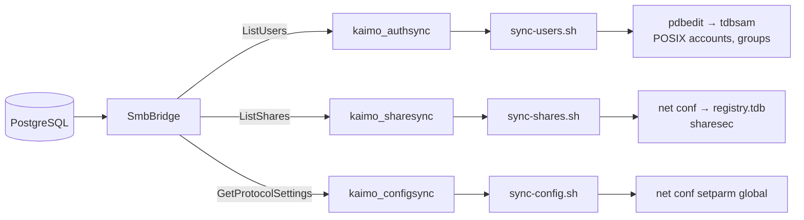

# SMB Control Plane (gRPC)

`Kaimo_File_Server.SmbBridge` is a .NET gRPC server that gives the Samba container access to Kaimo's
users, shares, ACLs, versions and settings. It is a thin facade over the Core services and contains
no business logic of its own. This document covers the transport, its security, the RPC contract and
the provisioning flow.

Related: [Samba VFS integration](samba-vfs-integration.md) ·
[Lifecycle events and snapshots](lifecycle-events-and-snapshots.md) ·
[Security model](../../architecture/security-model.md)

## Transport

- Kestrel listens on port **5080**, HTTP/2 only, TLS with a **required client certificate**
  (`src/Kaimo_File_Server.SmbBridge/Program.cs`).
- The bridge is attached only to the internal networks `kaimo_smb_control` (towards Samba) and
  `kaimo_bridge_database` (towards PostgreSQL). It has no route to the outside.
- The bridge never migrates the database; it waits in `WaitForDatabaseReadyAsync` until the Host
  has finished.

### PKI

On every start the Host runs `src/samba-vfs/generate-control-plane-certs.sh` (shipped in the Host
image as `/usr/local/bin/generate-control-plane-certs`, invoked by `ControlPlanePkiBootstrap` before
the database migration) and writes into `data/smb-control-plane/` (overridable with
`KAIMO_SMB_CONTROL_PKI` for externally managed certificates). The script is idempotent: an existing
PKI is kept, and files owned by another UID (a PKI created by the former root-run `pki-init`
container) are left as they are. A fresh generation writes `authority/.generating` until it has
finished; if the Host is stopped mid-run, the next start discards the partial files and generates
again instead of refusing the incomplete PKI. A failure is logged and does not stop the Host. The bridge waits
up to two minutes for its certificate files (`ControlPlaneTls.Load`) instead of depending on a
one-shot container:

| Material | Subject | Usage | Mounted into |
|---|---|---|---|
| Control-plane CA | `CN=Kaimo SMB Control Plane CA` (10 years) | Signs both leaf certificates | Both (certificate only) |
| Server certificate | `CN=kaimo_smb_bridge`, SAN `DNS:kaimo_smb_bridge` (825 days) | `serverAuth` | Bridge |
| Client certificate | `CN=kaimo-samba` (825 days) | `clientAuth` | Samba |

**Renewal.** On each start the script also renews, with the existing CA key, a leaf certificate that
expires within 365 days, and re-signs the CA (same key and subject) once it expires within 825 days;
the published `ca.crt` copies are refreshed whenever they differ from `authority/ca.crt`. Keys are
kept, so a bridge or Samba process still holding the old certificate or CA keeps interoperating with
the renewed files. Both load the files only at process start: restart `kaimo_smb_bridge` and
`kaimo_samba` after a renewal (the Host log says so). Without a readable `authority/ca.key`
(externally managed PKI, or a root-owned one from the former `pki-init`) nothing is renewed; an
expiring certificate is logged as a warning instead.

`ControlPlaneTls` (`src/Kaimo_File_Server.SmbBridge/Security/ControlPlaneTls.cs`) validates client
certificates against the dedicated CA only; the operating-system trust store is not used.

### RPC allow-list

After the handshake, `ControlPlaneAuthorizationInterceptor` checks the certificate identity against
`ControlPlaneAccessPolicy` (`src/Kaimo_File_Server.SmbBridge/Security/ControlPlaneAccessPolicy.cs`).
The single client identity `kaimo-samba` may call every RPC listed below **except `GetNtHash`**;
NT hashes are exported only through the paged, rate-limited `ListUsers`.

## Contract

Single source: `src/samba-vfs/protos/kaimo_smb_bridge.proto`, package `kaimo.smb.bridge.v1`. It
generates the C# server stubs and the C++ clients.

| Service | RPC | Caller | Backed by |
|---|---|---|---|
| `AuthService` | `ListUsers` | `kaimo_authsync` | `IAuthenticationLookup` (active users, decrypted NT hashes) |
| | `GetNtHash` | – (not allow-listed) | `IAuthenticationLookup` |
| `AuthzService` | `AuthorizeConnect` | `kaimo_authd` | `IFileService` / `IAclService` share access, SMB and share enabled state |
| | `AuthorizeOpen` | `kaimo_authd` | ACL evaluation of the requested SMB access mask; returns the granted mask |
| | `AuthorizeDelete` | `kaimo_authd` | ACL `Delete` / parent `DeleteSubItems`; returns `recycle_delete` and `recycle_root_depth` |
| | `AuthorizeRename` | `kaimo_authd` | Source delete, destination create, replaced-target delete in one decision |
| `EventService` | `NotifyClose`, `NotifyMkdir`, `NotifyDelete`, `NotifyRename` | `kaimo_authd` (spool) | `FileService.NotifyExternal*` (versions, ownership, ACL paths, change log) |
| `ShareService` | `ListShares` | `kaimo_sharesync` | `IShareRepository`, `HomeDirectoryService` |
| `ConfigService` | `GetProtocolSettings` | `kaimo_configsync` | `ISmbConfigStore` |
| `SnapshotService` | `EnumerateSnapshots`, `ResolveVersion`, `ReleaseVersionLease` | `kaimo_authd` | `IFileVersionService`, snapshot cache |

### Request validation

- Usernames and share names are validated (`SambaName`) and shares are resolved only when enabled
  (`EnabledShareResolver`).
- Every client path is normalized strictly (`ShareRelativePath.TryNormalizeStrict`) and contained in
  the share root. Client requests for the internal `.kaimo-*` namespaces are rejected.
- The raw SMB access mask is mapped bit by bit to `FilePermission`; generic and maximum-allowed bits
  are expanded first. The returned `granted_access_mask` never exceeds what the ACL allows.
- All RPCs honor gRPC cancellation.

## Provisioning plane

Three pull loops in the Samba container converge Samba's local state to the database. Each loop runs
a C++ client that fetches desired state as versioned JSON records, then a shell reconciler that
applies it idempotently, reads it back and reports freshness to the health check.

| Loop | Interval (default) | Applies |
|---|---|---|
| Users | `KAIMO_USER_SYNC_INTERVAL_SECONDS` (60) | Creates/updates POSIX accounts and `tdbsam` entries with the NT hash; locks and removes stale users; revokes their sessions |
| Shares | `KAIMO_SHARE_SYNC_INTERVAL_SECONDS` (2) | Adds, updates and removes registry shares (`path`, `browseable`, `guest ok = no`), writes `sharesec` for restricted shares, closes sessions on removed or moved shares |
| Protocol settings | `KAIMO_CONFIG_SYNC_INTERVAL_SECONDS` (2) | Min/max dialect, signing (`mandatory`/`auto`), encryption (`required`/`default`), WS-Discovery, audit logging, log level |

Registry configuration (`config backend = registry`, `registry shares = yes`) makes `smbd` read
changes live, without reload or restart.

### Steady state and failure streaks

- **Unchanged cycles are skipped.** `run-sync.sh` hands every reconciler a private record of its
  last verified pass (`/run/kaimo-sync/<component>.applied`). `sync-shares.sh` and `sync-config.sh`
  still pull the desired state on every cycle, but skip the `net`/`pdbedit`/`sharesec` calls when
  the reply is byte-identical and no local input changed: the registry, share-ACL, passdb and
  account-policy databases (inode, size, mode, timestamps), the share and close-capture directories
  (type, mode, owner, inode) and the files `sync-config.sh` writes. Each `net` call loads the full
  Samba configuration, so a full pass with a handful of shares costs about 0.5 s CPU; a skipped
  cycle costs about 50 ms, most of it the mTLS round trip.
- A record expires after `KAIMO_SYNC_FULL_RECONCILE_SECONDS` (default 60), which bounds drift that
  no file stamp reveals (for example a stopped `wsdd`). A failed pass deletes the record before it
  mutates anything, and the entrypoint deletes all records on container start.
- `ListShares` orders shares and `allowed_users` ordinally, so database row order cannot defeat the
  comparison.
- **A failure streak is contained once.** The first failed cycle of a component closes all sessions
  (`revoke-samba-sessions.sh`) and writes `/var/lib/kaimo-sync/<component>.contained`. Later failures
  of the same streak skip the revocation while that marker is newer than the component's last
  success: sessions opened after the first revocation passed the live VFS authorization (which fails
  closed without the bridge) against the same stale local state, so revoking them again adds no
  protection. The first failure after a success revokes again, and the entrypoint deletes all
  markers on container start.
- The fast path lives in `sync-applied-state.sh`, which both reconcilers source.

### NT hash export

- Kaimo stores `MD4(UTF-16LE(password))` — identical to Samba's NT hash — AES-256-GCM encrypted in the
  database.
- `ListUsers` returns pages of 1–1,000 users (at most 100,000 in total). Page zero is charged against
  `HashExportRateLimiter`; follow-up pages require a short-lived, client-bound continuation token for
  exactly the next offset, so offsets cannot be used to bypass the limit. Excess exports fail closed.
- Hash buffers are cleared after copying on both sides. `sync-users.sh` stages credentials only in
  the private `tmpfs` at `/run/kaimo-user-sync` and imports all pages before applying any.

## Observability

The bridge writes to the shared log archive under source `smb-bridge`. Samba's own output is archived
under source `samba` by `kaimo-samba-log-forwarder.py`.
