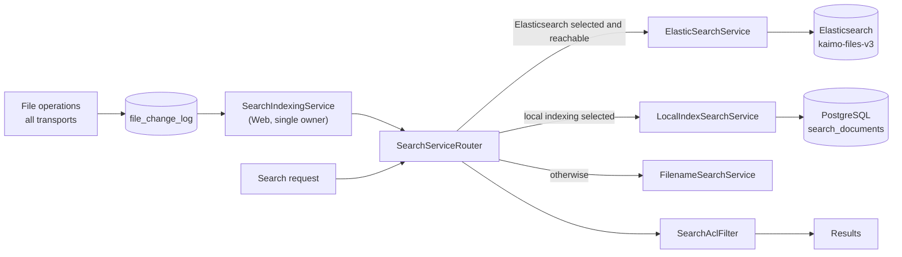

# Search and Indexing

Kaimo File Server searches file names and file content with one of two index engines, selected
under **Settings → Search**: Elasticsearch (separate container) or **local indexing** in the
application's PostgreSQL database. Exactly one engine is active; with neither selected — or with
Elasticsearch unreachable — search falls back to a file-name walk. Indexing is decoupled from file
operations: a single background indexer tails the change log, so no upload, rename or SMB close
ever waits on an index. Every result passes the same ACL filter.

Related: [Background services](../architecture/background-services.md) ·
[Storage and persistence](../architecture/storage-and-persistence.md) ·
[Search API](../external-access/search-api.md)

Source: `src/Kaimo_File_Server.Search/`, `src/Kaimo_File_Server.Infrastructure/Services/SearchIndexingService.cs`

## Components

| Component | Role |
|---|---|
| `SearchServiceRouter` | The `ISearchService` / `ISearchAdminService` every process resolves. Routes searches and index writes to the selected engine (`search.engine`): Elasticsearch when it also answers a ping, the local index unconditionally, otherwise the filename backend. A failing index search falls back to the filename backend |
| `ElasticSearchService` | Index management, document indexing, queries, full reindex |
| `LocalIndexSearchService` | Same contract over PostgreSQL via `ISearchIndexRepository` (`SearchIndexRepository` in Infrastructure); see [Local index](#local-index) |
| `SearchDocuments` | Conventions shared by both index engines: stable id `md5(absolutePath)`, directory documents, share resolution, reindex walk |
| `FilenameSearchService` | Walks every enabled share path and matches the query as a case-insensitive substring of the file name; skips hidden/internal folders and, unless requested, the recycle bin |
| `SearchAclFilter` | Reduces raw hits to items the caller may read (`ListReadData`), with one batched ACL query per share; hits in unresolvable or disabled shares are dropped (fail closed) |
| `ContentProvider` | Extracts text for indexing |
| `SearchIndexingService` | Tails `file_change_log` and applies index writes |

Registration: `AddElasticSearch` (`SearchServiceExtensions.cs`) is called before `AddCoreServices`,
so the router replaces the `NoOpSearchService` fallback. The Elasticsearch URL defaults to
`http://elasticsearch:9200`.

## Index

- Index name `kaimo-files-v3`. The suffix is versioned because analyzers are fixed when a field is
  created; changing an analyzer requires a new index. When the router finds the current index missing
  (first activation, a new version or a lost volume), `EnsureIndexAsync` creates it and the router
  starts a full reindex to fill it. The index whose full (all-shares) pass completed is recorded
  (config key `search.es.built-index`); until that record names the index in use, every start
  resumes the build, so an interrupted build (restart, cancel, outage) is never left half-done. Only
  after a completed pass are the indexes of earlier versions (`kaimo-files-v2`, `kaimo-files`)
  deleted. Search reads the new index while it is being filled.
- File names use an n-gram index analyzer of 2–20 characters (`kaimo_ngram_index`), content one of
  3–10 characters (`kaimo_content_index`; 2–20 made the index ~35x the size of the local one), both
  over letters and digits. The search analyzers split the query where the n-gram tokenizers split
  (any character that is no letter or digit: `.`, `_`, `:` …) and truncate each term to the longest
  indexed gram, so `invoice.pdf` and words longer than the span still match.
- `fileName.std` and `content.std` hold whole words (standard tokenizer, one token per CJK
  character) for ranking, fuzzy content matches and scripts without spaces.
- Every analyzer maps `ß` to `ss` (so `STRASSE` finds `Straße`). Names and content are stored in
  Unicode NFC and queries are normalized to NFC (macOS clients create decomposed names).
- Indexed content is capped at 200,000 characters (`MaxContentChars`): the n-gram analysis holds every
  distinct gram of a document in heap, and larger high-entropy content out-of-memory-kills a 512 MB
  node. Content beyond the cap is not searchable.
- A document Elasticsearch rejects (an HTTP error other than 502/503/504) is retried name-only, so
  the file name stays findable.
- The Host creates the index with the correct mapping at startup (`InitializeAsync`) before any
  document is written; otherwise Elasticsearch would auto-create it with a default mapping.
- Hidden paths (any segment starting with `.`: internal namespaces, version storage, `.git`, …) are
  never indexed (`ShareEntryPolicy.IsExcludedFromSearch`). The share's or home's own recycle bin is
  the exception: it is indexed, and searches leave it out unless asked for (see [Querying](#querying)).
- Symbolic links are never followed by the reindex walk (nor by the filename search), see
  [Symbolic links](#symbolic-links).
- A full reindex sweeps the documents of the walked shares whose files it did not visit (deleted or
  moved directly on the volume); documents written after the pass started are kept.

## Engine selection

- `search.engine` in `config_settings` holds `Elasticsearch`, `Local` or `Filename`. While it is unset,
  the legacy flag `search.elasticsearch.enabled` decides (true → Elasticsearch, false → Filename);
  saving an engine also writes the legacy flag, so a downgrade keeps using Elasticsearch only when
  it was selected.
- Each index engine keeps its own change-log cursor (`search.index.cursor` for Elasticsearch,
  `search.local.cursor` for the local index). The inactive engine's index is kept and catches up from
  the log when it is selected again (or is rebuilt if the log was pruned past its cursor).
- Switching away from the engine a reindex runs for cancels that reindex.

## Local index

- Table `search_documents` (migrations `AddLocalSearchIndex`, `AddSearchWordIndex`) with a trigram
  GIN index (`pg_trgm`) on `FileName`, a GIN index on the word vector `ContentTsv`, and
  `text_pattern_ops` b-tree indexes for prefix scans; table `search_terms` is the word dictionary
  (every word any document contains, trigram GIN index). `pg_trgm` is a trusted extension; external
  PostgreSQL servers need the `contrib` package, and the application's database user needs the
  `CREATE` privilege on the database. The migration runs for every installation, regardless of the
  selected engine, so without that privilege the app does not start.
- Word vector: the distinct words of the content, split and lowercased exactly like the query terms,
  words under three characters left out, stored as a tsvector without positions
  (`array_to_tsvector`). It holds at most 1 MB of words; a document with more distinct vocabulary
  keeps its leading words. The document, its vector and its new dictionary words are written in one
  statement.
- Query terms are runs of letters/digits with their combining marks (NFC, lowercased, at least 2
  characters, at most 10). Each term also matches in its spelling variants: decomposed (NFD names
  from macOS clients) and `ß`/`ss`. Each term matches as a case-insensitive substring (`ILIKE`) of
  the file name and — from three characters on — of any content word (within a word, not across
  word boundaries, like the n-grams); terms are OR-combined like the Elasticsearch `match` query.
  A content term is resolved to the dictionary words containing it (at most 5,000, shortest first),
  which are looked up in the word index; the content itself is never scanned. Ranking uses the
  Elasticsearch boosts (name 4, whole word in content 2, content word containing the term 1) over
  the whole content. The excerpt is cut in SQL around the first content match (`regexp_instr`),
  only for the returned page. The search statement runs with `enable_seqscan = off`: the planner
  underestimates reading the word vectors and otherwise picks a sequential scan on small tables.
- The dictionary only grows between rebuilds (deletes keep their words; they cost lookups, not
  results); compaction after a version rebuild rebuilds it from the stored word vectors.
- Renames and directory moves are a single transaction that rewrites id (`md5()` in SQL), paths and
  share, and marks the moved rows as current, so a reindex running meanwhile does not sweep them;
  subtree deletes are one statement.
- Change detection: a document stores the file's size and last-write time; an unchanged file is only
  touched, not re-extracted, so a repeated reindex is cheap. A full reindex then sweeps documents of
  the walked shares that were not touched (files removed out of band).
- Until a full (all-shares) build has completed with the current `SearchConfigKeys.LocalIndexVersion`
  (`search.local.built-version` in `config_settings`), the indexer starts one whenever local indexing
  becomes active, so a first build interrupted by a restart or an engine switch is restarted instead
  of leaving the index incomplete. The log is followed meanwhile. Such a build first clears all
  change-detection stamps, so unchanged files are re-extracted too, and afterwards rebuilds the word
  dictionary and compacts the tables (`VACUUM FULL`). Bump the version whenever extraction or the
  indexed path set changes. After the upgrade to version 5 (word vector), documents of an existing
  index are found by name only until the rebuild has re-extracted them.
- If the change log was pruned past an engine's cursor, the cursor only jumps to the head once the
  full rebuild has actually started; otherwise the indexer retries.
- In read-only demo mode (`KAIMO_DEMO_READONLY`) the local engine writes nothing and refuses a
  reindex; the demo index has to be built beforehand.
- Deliberate differences to Elasticsearch: no typo tolerance, no BM25 scoring, two-character terms
  match file names only, content terms match within single words, and stored content is capped at
  1,000,000 characters.

## Indexing pipeline

1. Every mutation through `IFileService` (web, REST, WebDAV, SMB events via the bridge, syncs)
   appends to `file_change_log`. File operations do not call any index.
2. `SearchIndexingService`, registered only in the Web process, reads entries with `Seq` greater
   than the active engine's cursor in batches of 200 every 3 s, applies create/modify/delete/rename
   through the router and persists that cursor in `config_settings`.
3. While no index engine is active (or Elasticsearch is unreachable), the cursor is not advanced; the
   log buffers changes until the indexer catches up (bounded by the change-log retention window).
   The same holds when Elasticsearch drops out mid-batch (no answer, or HTTP 502/503/504): the batch
   stops before that entry, the cursor stays on the last applied one and the indexer backs off for
   10 s. An entry the engine drops out on 3 times in a row is skipped as a likely engine crasher;
   any other per-entry failure is logged and skipped at once.
4. A single, `Seq`-ordered reader gives a total order, so create and delete of the same path cannot
   race.
5. Hidden paths are never indexed, the same rule the full reindex applies; the recycle bin is not
   hidden, so a delete to it or a restore from it is a plain rename. A move into a hidden folder
   removes the entry; a move out of one indexes the file fresh, or reindexes the share for a folder.
   Deletes of hidden paths are still applied.
6. The index is derived: a manual full reindex (`ReindexAllAsync`) rebuilds it from the file system
   and heals any lost or poisoned entry.

## Content extraction

`ContentProvider` (`ContentProivder.cs`) reads at most 25 MiB per file and extracts text by extension:

| Format | Extractor |
|---|---|
| PDF | PdfPig |
| `.docx`, `.docm`, `.xlsx`, `.xlsm`, `.pptx`, `.pptm` | OOXML part parsing (`System.IO.Compression` + `XDocument`) |
| `.xls` | ExcelDataReader |
| `.odt`, `.ods`, `.odp` | OpenDocument XML |
| `.svg` | Not extracted; indexed by name only |
| Other | Magic bytes: `%PDF-` goes to PdfPig, a ZIP is tried as a Word document; otherwise text is indexed and binary data (media, archives, executables) is indexed by name only |

A file that cannot be parsed (corrupt or encrypted) is still indexed by its name. A parser that
takes the whole process down (out of memory, stack overflow) is caught by a crash guard: a marker
named after the SHA-256 of the content, counting the attempts in flight, is written to
`<ApplicationDataPath>/.kaimo-extract-guard` before parsing and removed afterwards. One attempt that
died is retried (it may have been an unrelated shutdown); after two, the content is indexed by name
only and a warning names the marker to delete for another try.

Plain text: a head with a NUL byte or more than 5 % other control bytes is binary; stray controls
(ESC of colored logs, form feeds) are not. UTF-16 is decoded by its byte-order mark, bytes that are
no valid UTF-8 as Windows-1252. Plain text is stripped of encoded payloads first: runs of at least
60 base64/base64url characters whose letters and digits switch between upper case, lower case and
digit at more than 42 % of neighbor pairs (random data; identifiers, compounds such as
`…verordnung2024` and slugs stay well below) carry no searchable words but would otherwise dominate
the index size. Hex runs up to 128 characters are hashes and kept.

Every extracted text is finally cleaned: ANSI escape sequences are removed, other control characters
become spaces, the private-use highlight markers (U+E000/U+E001) are dropped and the text is
normalized to NFC.

## Symbolic links

Symbolic links inside a share can only be created directly on the volume (no transport creates
one). The server never follows them: `FileSystemStorage` treats any path that passes through a link
as missing (one `lstat` per path segment), listings, archives and folder sizes skip them, and the
reindex and filename walks do not enter them. A link to `/etc/passwd` therefore cannot be served,
written through, archived or indexed, and a loop (`x -> .`) cannot multiply entries. Samba applies
its own link settings to SMB access.

## Querying

- Search terms are used only in `match` queries (Elasticsearch) or as bound parameters with escaped
  LIKE wildcards (local index), never spliced into a query, and are not logged.
- Recycle-bin documents (any `.RECYCLE_BIN` segment) are left out unless the caller asks for them
  (`includeRecycleBin`, e.g. in the REST body) or the folder scope itself lies in a recycle bin. The
  web search bar always fetches them and its recycle-bin toggle only filters the shown hits, so it
  switches the results live without another query. Elasticsearch filters with a `regexp` `must_not` on
  `sharePath`, the local index with a case-insensitive regex on `SharePath`.
- Raw hits are ACL-filtered in pages (`SearchLimits`): paging stops after 50 readable hits or 1,000
  scanned raw hits, so restrictive ACLs do not produce an empty first page.
- Results carry share, share-relative path, name, type, size and highlighted snippet segments, never
  server paths or full indexed text.
- Both engines mark matches internally with private-use characters that indexed text never holds and
  convert them to `<mark>` tags last (`SearchDocuments.ToMarkup`, `LocalIndexSearchService.Mark`),
  after removing literal `<mark>` tags of the file name or content, so a file cannot fake a highlight.
- The REST endpoint `POST /api/v1/search` adds a per-user token-bucket rate limit and a 10-second
  time box; concurrent filename walks are capped process-wide.
